# NextGenCockPit — Sensor-Fusion Instrument Cluster

A next-generation automotive **digital instrument cluster** built with **Qt 6 / QML** (and a minimal C++ entry point).
It is a 1920 × 720 display that fuses LiDAR, radar, camera and vehicle-health signals into one calm, read-only
driver view — and explains *why* it is warning you, not just *that* it is.

The cluster takes **no touch, mouse or keyboard input**. Everything on screen is driven by vehicle signals.
Today those signals come from a built-in simulator (`VehicleSim.qml`); in a car you replace the simulator with
your CAN / SOME-IP / VSS feed and the display does not change.

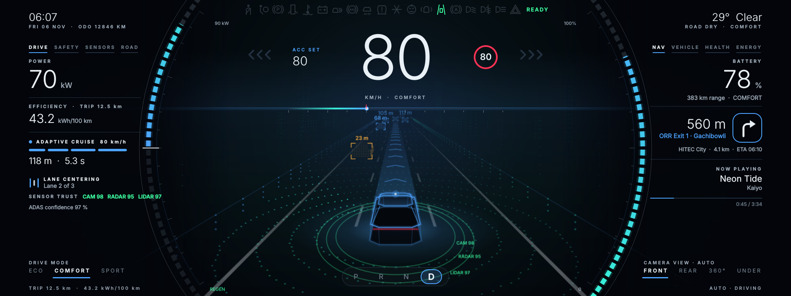

---

## Highlights

- **Sensor-fusion scene** with four automatically selected camera views: **Front** (chase-cam LiDAR world, scan rings, ACC path, blind-spot zones), **Rear** (guide lines, objects, pedestrian, rear auto-brake), **360° Top** (bird's-eye with blind-spot zones, or the parking bay in reverse) and **Under** (see-through underbody with obstacle, wheels, tyre pressure and alignment).
- **Context manager** — the view and the side cards switch by themselves from the vehicle state (gear, speed, obstacles, indicators, faults) with hold times, so the screen never flickers between pages.
- **Eight information cards**, four on each side: *Drive · Safety · Sensors · Road* on the left and *Nav · Vehicle · Health · Energy* on the right.
- **Evidence Card** — when a warning appears, a read-only card shows the signal history behind it, the threshold it crossed and one action to take. It is a deterministic rule table, **no AI**.
- **Mode-driven theme** — Eco (mint), Comfort (azure), Sport (ember) and Reverse (violet). Colours glide between states and a light wipe plays on every drive-mode change.
- **Full telltale strip** — every lamp is always present (ghosted when off) so the driver learns the layout; active lamps light in their regulated colours.
- **Glance budget** — if the driver's eyes-off-road time exceeds 2 s the side cards dim to 10 %.
- **Linked co-pilot display** (1280 × 480) bound to the same data, so a change on one screen shows on the other instantly.
- **Runs hands-free** — a scripted 200-second test drive injects every scenario automatically.

## Screenshots

All images are 1920 × 720 captures of the running cluster, taken from the built-in scripted demo.

### Drive modes

| Sport | Eco |
|---|---|
| 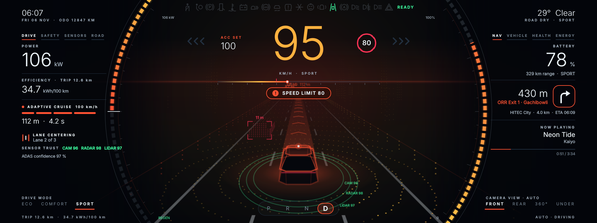 | 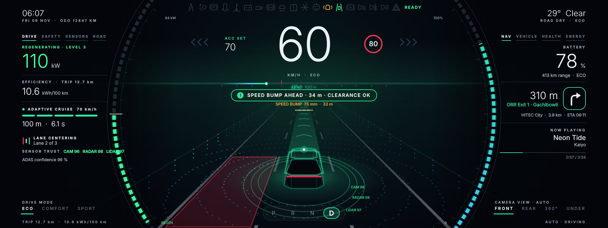 |

### Driving situations

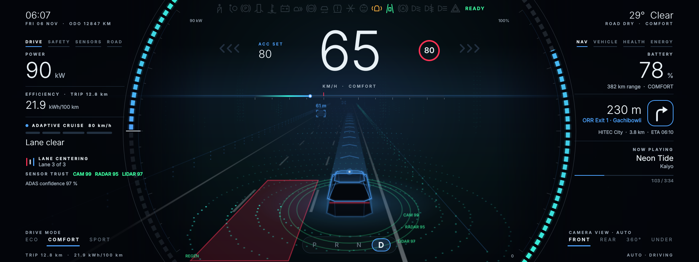
*Lane change: the blind-spot zone on the target side is highlighted in red.*

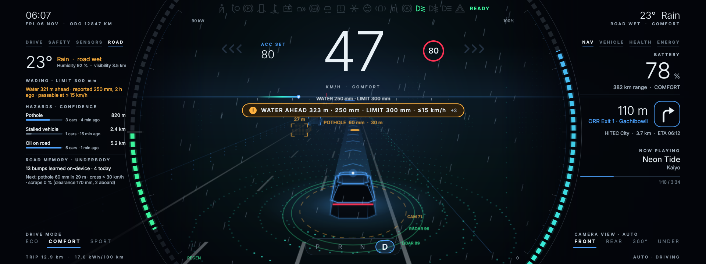
*Rain: road-surface card, monsoon **wading check** (water depth against the vehicle's wading limit), community hazards with confidence, and the underbody strike predictor.*

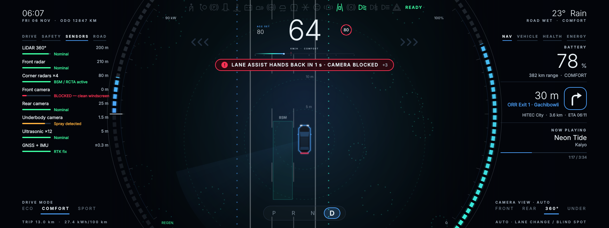
*Lane markings end ahead: a **takeover countdown** tells the driver when lane assist hands control back, next to the sensor-health card.*

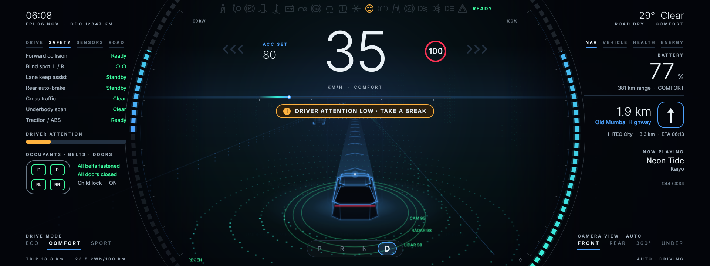
*Driver attention low: the attention bar on the Safety card drops and a "take a break" alert appears.*

### Health and faults

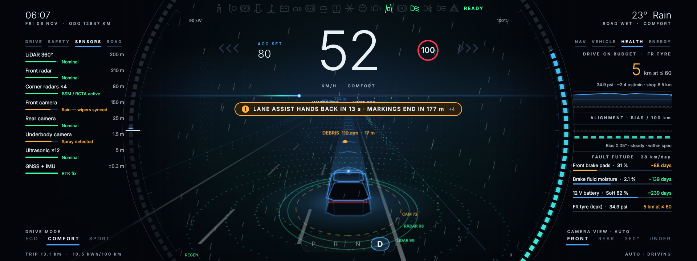
*Slow puncture: **drive-on budget** (how far the car can still be driven and at what speed), tyre-pressure trend, alignment and **fault-future** projections for wear items.*

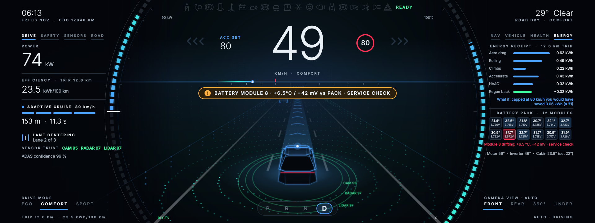
*Energy card: trip **energy receipt** with a what-if, and the 12-module battery pack **heat-map** flagging a drifting module (+6.5 °C, −42 mV).*

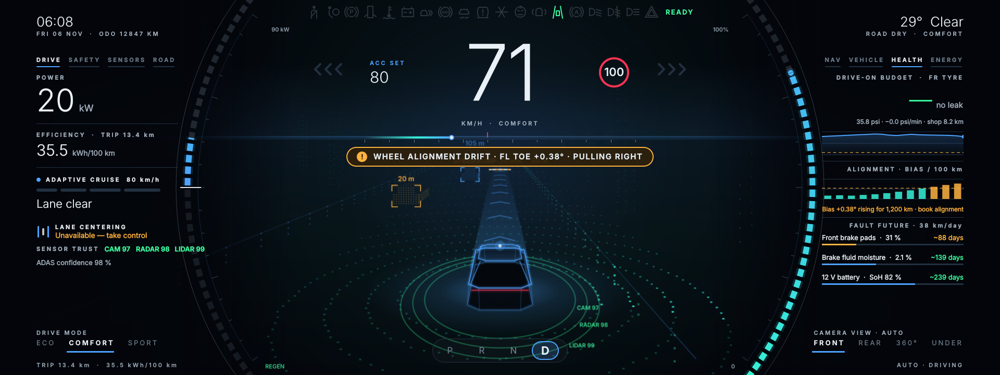
*Alignment drift: steering-bias trend per 100 km, with an alert when the front-left toe leaves its limit.*

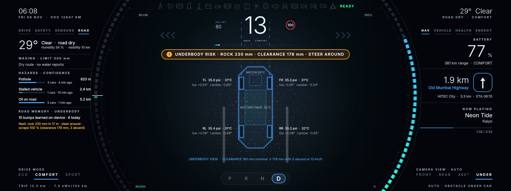
*Underbody camera view: tyre pressure, toe and camber at each wheel, motor and battery temperatures, and the **strike predictor** for a rock ahead.*

### Reversing

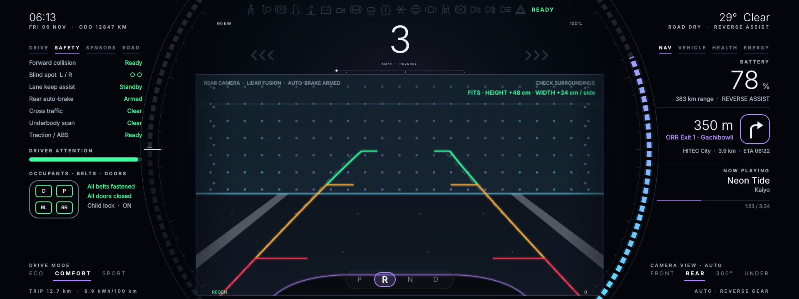
*Reverse gear: violet theme, rear camera with guide lines, a 3D **fit check** for the load, and the rear auto-brake armed.*

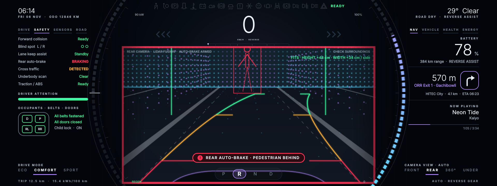
*A pedestrian behind the car: the frame turns red and the rear auto-brake engages.*

### Companion windows

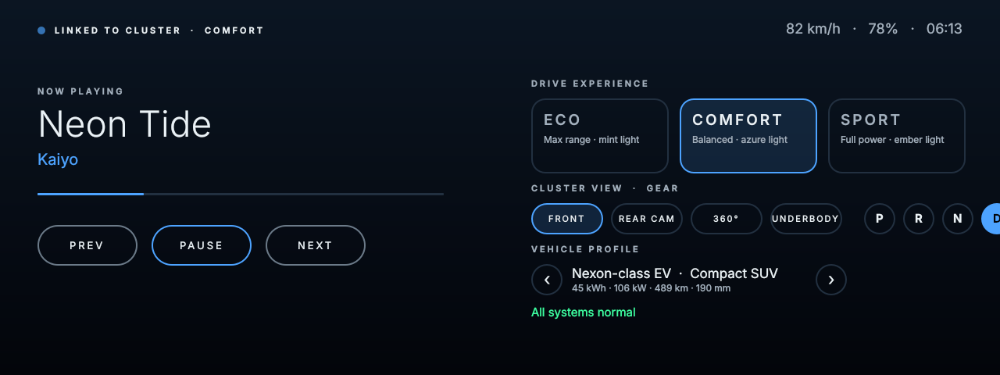
*Co-pilot display (1280 × 480), linked to the cluster: media, drive mode, camera view, gear and vehicle profile.*

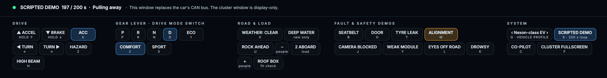
*Signal Simulator: the development test bench that stands in for the car's CAN bus.*

---

## The cards

| Side | Card | What it shows |
|---|---|---|
| Left | **Drive** | Power / regeneration, efficiency, adaptive cruise and lane centring, sensor trust and ADAS confidence; rear clearance in reverse |
| Left | **Safety** | Live status of every assistance system, occupants and doors |
| Left | **Sensors** | Health, range and notes for LiDAR, radars, cameras, ultrasonics and GNSS + IMU |
| Left | **Road** | Weather and surface, wading check, community hazards with confidence decay, offline road memory, underbody strike predictor |
| Right | **Nav** | Battery and range, turn-by-turn guidance, now playing |
| Right | **Vehicle** | Selectable vehicle profile, specifications, tyres (TPMS) and alignment |
| Right | **Health** | Drive-on budget, alignment drift trend, fault-future projections |
| Right | **Energy** | Trip energy receipt with what-if, battery pack heat-map, powertrain and cabin temperatures |

## Next-gen concepts included

Sensor Trust Meter · Takeover countdown · Escape path · 3D fit check (garage / roof box) · Underbody strike predictor ·
Evidence Card · Drive-on budget · Alignment drift trend · Battery pack heat-map · Fault future ·
Community hazards with confidence decay · Offline road memory · Monsoon wading check · Glance budget · Energy receipt.

---

## Architecture

```
 Signal Simulator window  ──►  VehicleSim.qml  ──►  Theme.qml  ──►  cluster screens
 (stands in for CAN bus)       (all vehicle data)   (mode palette)    (read-only views)
                                       │
                                       └──►  Co-pilot display (same data, second window)
```

- `VehicleSim.qml` is the single data model. Every screen element only **reads** its properties.
  **To go live, replace the simulation in `step()` / `slowStep()` with your CAN / SOME-IP / VSS signals.**
- `main.qml` hosts the 1920 × 720 stage (scaled to fit any window) and the context manager.
- `SignalSimulator.qml` + `ControlDeck.qml` are a development test bench — remove them when real signals are wired.

| File | Role |
|---|---|
| `main.cpp`, `CMakeLists.txt` | Qt application entry point and build |
| `main.qml` | Cluster window, layout, context manager, boot splash |
| `VehicleSim.qml` | Vehicle data model and simulation (vehicle profiles, dynamics, ADAS, faults, scripted demo) |
| `Theme.qml` | Mode-driven colour palette and helpers |
| `LidarScene.qml` | Sensor-fusion scene — front / rear / 360° top / underbody views (rendered at 75 % resolution and up-scaled for speed) |
| `LensFrame.qml` | Curved lens brackets: power / regen on the left, battery state of charge on the right |
| `SpeedCluster.qml`, `GearRail.qml`, `Telltales.qml`, `TelltaleIcon.qml`, `Indicator.qml`, `TurnArrow.qml` | Speed core, gear indicator, telltale strip, turn signals |
| `LeftPanel.qml`, `RightPanel.qml`, `DeckTabs.qml` | Card containers and tabs |
| `CardDrive/Safety/Sensors/Road.qml`, `CardNavMedia/Vehicle/Health/Energy.qml` | The eight cards |
| `EvidencePanel.qml`, `AlertBanner.qml`, `Sparkline.qml` | Evidence Card, highest-priority alert banner, mini charts |
| `ModeDock.qml`, `Caption.qml`, `Backdrop.qml` | Drive-mode / camera-view docks, text caption, background |
| `CoPilotDisplay.qml` | Linked second display |
| `SignalSimulator.qml`, `ControlDeck.qml`, `DeckButton.qml` | Test bench window, signal-injection panel and its buttons |

---

## Build and run

**Requirements:** Qt 6.2 or newer with the **Qt Quick** module, CMake 3.16+ and a C++ compiler (MinGW, MSVC, GCC or Clang).

**Qt Creator:** open `CMakeLists.txt`, select a Qt 6 kit and press **Run**.

**Command line:**

```bash
cmake -S . -B build -DCMAKE_PREFIX_PATH=/path/to/Qt/6.x/<kit>
cmake --build build
./build/appNextGenCockpit        # appNextGenCockpit.exe on Windows
```

Two windows open: the **cluster** (1920 × 720) and the **Signal Simulator** below it. The scripted demo starts
automatically. The UI font is **Segoe UI**; on systems without it Qt falls back to another sans-serif font.

> The module is built with `NO_CACHEGEN` (QML compiled at startup) to avoid a Qt 6.8 + MinGW Makefiles
> "No rule to make target .rcc/qmlcache/..." error.

## Controlling the simulator

Click the **Signal Simulator** window (it needs keyboard focus), then use the buttons or these keys:

| Key | Action | Key | Action |
|---|---|---|---|
| ↑ / ↓ | Accelerate / brake (hold) | `P` `R` `N` `D` | Gear |
| ← / → | Turn signals | `Z` | Hazard lights |
| `1` `2` `3` | Eco / Comfort / Sport | `H` | High beam |
| `A` | Adaptive cruise on / off | `X` | Cycle weather |
| `G` | Cycle vehicle profile | `U` | Rock ahead |
| `T` | Tyre leak | `W` | Alignment fault |
| `J` | Camera blocked | `Y` | Weak battery module |
| `K` | Driver drowsy | `L` | Eyes off road |
| `B` | Passenger seatbelt | `O` | Rear door open |
| `S` | Scripted demo on / off | `M` | Next track |
| `C` | Show / hide co-pilot display | `F` | Cluster fullscreen |

### Scripted demo (200 s loop)

Highway cruise with adaptive cruise → lane changes with blind-spot check → monsoon rain and wading check → camera blocked →
slow puncture → battery module drifting → rock ahead → driver drowsy → alignment drift → arrival and parking →
reverse into a bay with pedestrian and rear auto-brake → 360° view → pull away.

## Vehicle profiles

Four selectable profiles — *Nexon-class EV*, *City Hatch EV*, *Grand Tourer EV* and *Trail SUV EV* — change battery size,
power, range, mass, ground clearance, tyres, height and wading depth. Figures are approximate public values; edit
`profiles` in `VehicleSim.qml` to match the exact variant you target.

## Status

This is a working prototype driven by **simulated data**. It is a design and engineering demonstrator and has not been
validated or certified for use in a real vehicle.
